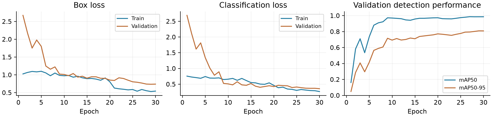
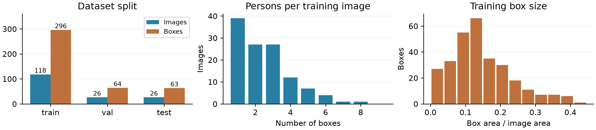
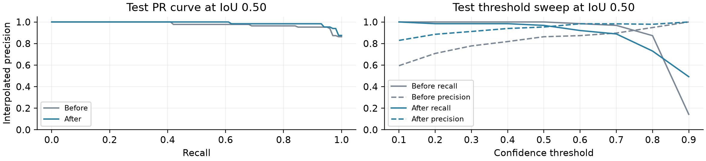

# YOLOv10n 보행자 객체검출 실험

Hugging Face의 **YOLOv10n**을 Penn-Fudan 데이터셋에 30 epoch 파인튜닝하고, 학습 전후를 동일한 테스트셋으로 비교한 실험입니다. 로컬 컴퓨터에서 Runpod API로 GPU Pod를 생성하고 SSH로 실험을 실행했습니다.

**핵심 결과:** 신뢰도 0.25에서 오탐은 **21→6개**로 감소했지만, 엄격한 위치 평가인 **mAP50–95는 0.8859→0.8431로 하락**했습니다. 소량 파인튜닝의 효과를 정밀도·재현율·위치 정확도로 나누어 해석합니다.

## 실험 구성

| 항목 | 설정 |
|---|---|
| 모델 | [`jameslahm/yolov10n`](https://huggingface.co/jameslahm/yolov10n), COCO 80종 사전학습 |
| 가중치 고정 revision | `3b91f578c5b492080f191a26aa35711bb44f608c` |
| 데이터 | [Penn-Fudan](https://www.cis.upenn.edu/~jshi/ped_html/), 170장·실측 423개 보행자 |
| 학습 / 검증 / 테스트 | 118장·296개 / 26장·64개 / 26장·63개 |
| 입력 / 학습 | `imgsz=640`, batch 16, 30 epoch, seed 42 |
| 최적화 | AdamW, 초기 학습률 0.001, weight decay 0.0005, AMP 비활성화 |
| 증강 | Ultralytics 기본 증강, 마지막 10 epoch Mosaic 종료 |
| 모델 선택 | 검증 mAP50–95 최고인 epoch 29의 `best.pt` |
| 환경 | RTX 4090, Python 3.12.3, PyTorch 2.9.1+cu128, torchvision 0.24.1+cu128, Ultralytics 8.4.175 |
| 학습 소요 | 65.64초: `model.train()` 벽시계 시간, 데이터 다운로드·환경 설치 제외 |

공개 소개와 PyTorch 튜토리얼은 객체 수를 345개로 설명하지만, 이 실험에서 받은 ZIP의 **170개 주석 파일과 인스턴스 마스크는 모두 합계 423개**입니다. 코드가 두 값을 직접 대조합니다. ZIP SHA-256은 `9095a9613c95586f1c7f2a327d454833d16e0f5e17e5f83d35027ffd315b48e2`입니다.

## 실제 테스트 결과

| 지표 | 사전학습 | 파인튜닝 |
|---|---:|---:|
| mAP50–95 | 0.8859 | 0.8431 |
| mAP50 | 0.9771 | 0.9897 |
| mAP75 | 0.9299 | 0.9093 |
| 정밀도 | 0.7500 | 0.9118 |
| 재현율 | 1.0000 | 0.9841 |
| TP / FP / FN | 63 / 21 / 0 | 62 / 6 / 1 |

- mAP는 `pycocotools.COCOeval`로 계산합니다. 단일 `person` 클래스이므로 클래스 평균 AP와 동일합니다. IoU는 0.50~0.95, 0.05 간격이며 `maxDets=[1,10,100]`입니다.
- 정밀도·재현율은 **confidence ≥ 0.25, IoU ≥ 0.50**에서 점수 순 일대일 매칭으로 계산합니다. mAP 입력의 confidence 하한은 0.001입니다. 두 임계값을 혼동하지 않습니다.
- 사전학습 모델은 COCO의 `person=0`만 평가하고, 파인튜닝 모델도 `person=0`으로 평가합니다. 평가 입력은 **이미지 한 장씩**입니다.
- 검증 곡선은 Ultralytics 평가기, 최종 테스트 성능은 COCOeval에서 나옵니다. 평가셋과 구현이 다르므로 같은 점수라고 가정하지 않습니다.



학습 box loss는 1.024→0.541, 검증 box loss는 2.670→0.737로 낮아졌습니다. 마지막 구간에 검증 손실이 지속적으로 증가하는 양상은 뚜렷하지 않습니다. 다만 학습·검증 손실의 조건이 다르고, 분할이 작기 때문에 이 곡선만으로 일반화나 과적합 부재를 단정할 수 없습니다. 사전학습 80종 검출 헤드는 1종 헤드로 교체되므로, 첫 epoch의 검증 점수는 원래 사전학습 모델의 기준 성능이 아닙니다.



학습 이미지당 객체 수 중앙값은 2개, 박스 면적 비율 중앙값은 약 13.0%입니다. 큰 객체 비중과 배경의 반복 가능성 때문에 이 결과를 야간·원거리·다른 카메라 환경으로 바로 일반화하기 어렵습니다.



PR 그래프는 IoU 0.50의 보간 정밀도입니다. 높은 IoU에서의 위치 정확도까지 설명하지 않으므로, PR과 mAP50가 좋아져도 mAP50–95가 낮아질 수 있습니다. 임계값 그래프는 **결과 분석용**이며 테스트셋으로 운영 임계값을 선택하지 않았습니다.

## 재현 방법

### 1. 로컬 데이터 준비

```bash
python3 -m venv .venv
source .venv/bin/activate
pip install -r requirements-local.txt
python experiments/prepare_data.py
```

공식 ZIP을 내려받아 출처별 층화 후 seed 42로 이미지를 나눕니다. 인스턴스 마스크의 최소·최대 좌표를 반열린 `xyxy` 박스로 바꾸고, YOLO의 정규화된 `(cx, cy, w, h)`로 저장합니다. 중복 이미지와 좌표 범위를 검사하고 `data/experiment_data.zip`을 생성합니다. 원본 데이터·마스크·실험 모델은 저장소에 업로드하지 않습니다.

### 2. Runpod Pod 생성

키를 로컬 프로세스 환경에 설정합니다. 키를 명령 기록이나 저장소에 기록하지 않는 입력 예입니다.

```bash
read -r -s RUNPOD_API_KEY
export RUNPOD_API_KEY
mkdir -p .private
chmod 700 .private
ssh-keygen -t ed25519 -f .private/visionai_runpod -N '' -C visionai-object-detection
python experiments/runpod_control.py create --budget-usd 5 --max-runtime-minutes 30
nohup python experiments/runpod_control.py watchdog > .private/watchdog.log 2>&1 &
python experiments/runpod_control.py status
```

이 단계부터 GPU 요금이 발생합니다. `status`가 반환한 `publicIp`와 `portMappings["22"]`를 아래 변수에 넣습니다. GPU 재고와 요금은 달라질 수 있으며, 클라이언트는 시간당 1.5달러 초과 견적을 거부합니다. 로컬 watchdog이 예산·시간 중 먼저 도달하는 시점에 실험 Pod를 삭제합니다. 로컬 컴퓨터를 종료하면 watchdog이 동작하지 않으므로 Runpod 콘솔에서도 종료 여부를 확인해야 합니다.

```bash
GPU_HOST="YOUR_POD_PUBLIC_IP"
GPU_PORT="YOUR_POD_SSH_PORT"
scp -i .private/visionai_runpod -P "$GPU_PORT" \
  experiments/gpu_experiment.py data/experiment_data.zip root@"$GPU_HOST":/workspace/
ssh -i .private/visionai_runpod -p "$GPU_PORT" root@"$GPU_HOST"
```

### 3. GPU에서 실행

Pod의 SSH 터미널에서 실행합니다. Runpod 키는 GPU로 전달하지 않습니다.

```bash
python -m venv --system-site-packages /workspace/visionvenv
source /workspace/visionvenv/bin/activate
pip install torch==2.9.1 torchvision==0.24.1 \
  --index-url https://download.pytorch.org/whl/cu128
# 로컬 requirements.txt도 scp로 보내거나 동일 버전을 설치합니다.
pip install ultralytics==8.4.175 huggingface_hub==2.2.0 \
  safetensors==0.8.0 pycocotools==2.0.11 numpy==2.5.3 \
  matplotlib==3.11.2 Pillow==12.3.0 PyYAML==6.0.3
mkdir -p /workspace/visionai
cp /workspace/experiment_data.zip /workspace/visionai/
python -u /workspace/gpu_experiment.py \
  > /workspace/visionai/experiment.log 2>&1
```

스크립트가 Hugging Face의 고정 revision 가중치를 내려받고, 키 이름을 검사한 후 `strict=True`로 로딩합니다. 사전학습 평가 → 30 epoch 학습 → 검증으로 선택한 best 모델의 테스트 평가를 순서대로 수행합니다. 동일 데이터·모델·설정으로 실행해도 GPU와 패키지 환경에 따라 수치 차이가 생길 수 있습니다.

### 4. 결과 회수와 종료

학습이 끝나면 GPU SSH 터미널에서 묶은 뒤 로컬 터미널에서 내려받습니다.

```bash
# GPU에서
cd /workspace/visionai
tar -czf /workspace/experiment-results.tar.gz results experiment.log

# 로컬에서
scp -i .private/visionai_runpod -P "$GPU_PORT" \
  root@"$GPU_HOST":/workspace/experiment-results.tar.gz .
tar -xzf experiment-results.tar.gz
python experiments/runpod_control.py delete
python experiments/make_figures.py
```

다운로드·정상 완료를 확인한 다음 Pod를 삭제합니다. 삭제는 해당 실험 Pod의 원격 데이터를 제거합니다. 이 실험의 GPU 세션은 약 8.46분, 표시 요율 기준 GPU 비용 추정은 약 0.13달러였으며 Pod 삭제까지 확인했습니다. 계정의 실제 청구액과 디스크 등 추가 요금은 Runpod에서 확인합니다.

## 저장소 구조

```text
experiments/
  prepare_data.py       # 공식 ZIP 다운로드, 검증, YOLO 박스, 분할 manifest
  gpu_experiment.py     # HF 가중치 로딩, 사전/사후 평가, 학습
  runpod_control.py     # 로컬 API 클라이언트, 생성·상태·삭제·watchdog
  make_figures.py       # EDA, 학습 곡선, 예측 비교, PR/임계값 그래프
results/
  before_metrics.json  # 최종 batch 1 평가의 사전학습 지표
  after_metrics.json   # 최종 batch 1 평가의 파인튜닝 지표
  environment.json     # 모델 revision, 설정, 실행 환경
  train/results.csv    # 실제 30 epoch 학습 로그
figures/               # 데이터 사진을 포함하지 않는 공개 분석 그래프
```

`make_figures.py`는 재현 후 로컬에 내려받은 테스트 이미지와 예측 JSON으로 검출 비교 그림도 만듭니다. 보고서에는 실제 Hugging Face 모델 카드 캡처, 핵심 코드·실행 출력 발췌, 정답/학습 전/학습 후 비교를 별도로 포함했습니다.

## 해석과 한계

1. **오탐 감소와 위치 정확도 개선은 다릅니다.** 같은 confidence에서 정밀도는 약 16.2%p 상승했지만 mAP50–95는 약 4.3%p 하락했습니다. 사전학습 모델의 위치 성능을 보존하는 학습률·백본 동결 비교가 다음 실험 과제입니다.
2. **일부 FP는 미주석 보행자입니다.** 원본 주석은 작거나 심하게 가려진 사람을 제외할 수 있습니다. 화면에 실제 사람이 있어도 정답 박스가 없으면 평가상 FP가 되므로, 수치상의 오탐을 전부 모델의 환각으로 해석하지 않습니다.
3. **분할과 표본의 한계가 있습니다.** 동일 이미지 SHA 중복은 없지만 장면 ID가 없어 배경/유사 장면 중복까지 배제하지 못했습니다. 테스트 26장·63개와 seed 한 번으로 얻은 수치에는 불확실성이 있습니다.
4. **실서비스 검증은 별도입니다.** 매장/캠퍼스 혼잡도 집계에 응용하려면 검출을 추적과 결합하고, 다른 카메라·시간대·빈 장면·원거리·가림 데이터를 독립적으로 평가해야 합니다. 모델 추론 시간에 통신·영상 처리 시간을 더한 서비스 지연도 확인해야 합니다.

## 출처와 라이선스

- [Hugging Face 모델 카드](https://huggingface.co/jameslahm/yolov10n): AGPL-3.0 표기. 원본 모델 카드와 배포 라이브러리의 조건을 확인합니다.
- [YOLOv10 논문](https://arxiv.org/abs/2405.14458), [Ultralytics YOLOv10 문서](https://docs.ultralytics.com/models/yolov10/): 학습의 one-to-many/one-to-one 할당과 NMS 없는 추론.
- [Penn-Fudan 공식 데이터](https://www.cis.upenn.edu/~jshi/ped_html/), [PyTorch 튜토리얼](https://docs.pytorch.org/tutorials/intermediate/torchvision_tutorial.html): 데이터 출처와 마스크→박스 개념. 공개 접근 가능성을 재배포·상업 사용 허가로 해석하지 않습니다.
- [COCO 공식 평가 코드](https://github.com/cocodataset/cocoapi): 최종 성능 계산.
- [Runpod API 문서](https://docs.runpod.io/api-reference/pods/POST/pods): 로컬에서 제어한 GPU Pod.

실험 설계·코드 정리·문서 작성에는 Codex의 도움을 받았고, 모든 결과 수치와 그래프는 실제 데이터와 GPU 실행 산출물에서 생성했습니다. 강의자료의 예시 수치나 미실행 학습 결과는 사용하지 않았습니다.
